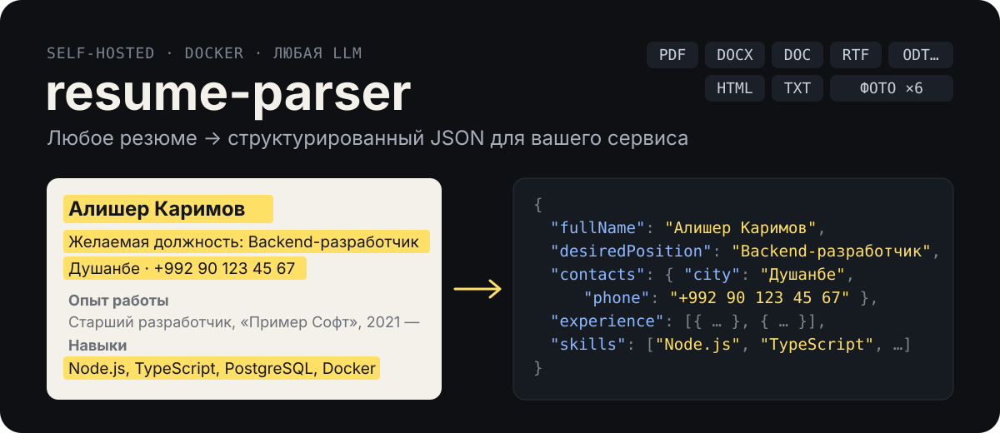

<p align="center">
  
</p>

Сервис принимает резюме в любом формате (PDF, DOC, DOCX, RTF, ODT, TXT, HTML, фото или скан) и возвращает JSON одной схемы. Запускается в Docker рядом с вашим проектом, работает с любой LLM: Gemini, OpenAI-совместимые облака (OpenAI, DeepSeek, Qwen) или локальная модель без ключа.

Файлы не сохраняются: документ обрабатывается в памяти и уходит только в выбранную вами LLM.

## Что на выходе

```json
{
  "resume": {
    "fullName": "Алишер Каримов",
    "desiredPosition": "Backend-разработчик",
    "contacts": { "email": "alisher.karimov@example.com", "phone": "+992 90 123 45 67", "city": "Душанбе", "links": [] },
    "experience": [
      { "company": "ООО «Пример Софт»", "position": "Старший разработчик", "city": "Душанбе",
        "startDate": "2021-03", "endDate": null, "current": true, "description": "Разработка REST API на Node.js и PostgreSQL…" }
    ],
    "education": [{ "institution": "Таджикский технический университет", "degree": "бакалавр", "field": "информатика", "startYear": 2014, "endYear": 2018 }],
    "skills": ["Node.js", "TypeScript", "PostgreSQL", "Docker", "Git"],
    "languages": [{ "name": "английский", "level": "B2" }],
    "salary": { "from": null, "to": null, "currency": null, "period": null }
  },
  "meta": { "format": "docx", "model": "gemini-3.5-flash", "ms": 4210, "grounded": true, "unverified": [], "warnings": [] }
}
```

Полная схема (опыт, образование, языки, зарплата, занятость, график, переезд, командировки, дата рождения) описана в [`src/lib/parser/schema.ts`](src/lib/parser/schema.ts). Если значения нет в документе, поле равно `null` или `[]`: модель ничего не додумывает. Каждое значение сверяется с текстом документа, а неподтверждённые попадают в `meta.unverified`.

## Быстрый старт

Нужны Python 3.9+ и Docker.

```bash
pip install git+https://github.com/komilovsg/resume-parser
resume-parser init              # спросит про LLM, создаст .env и docker-compose.yml
docker compose up -d --build    # соберёт и поднимет сервис на :8080
```

```python
from resume_parser import parse_resume

data = parse_resume("cv.pdf")              # путь, bytes или файловый объект
print(data["resume"]["fullName"])

data = parse_resume(["p1.jpg", "p2.jpg"])  # одно резюме на нескольких фото, до 6 по порядку страниц
```

Клиент берёт адрес и токен из `RESUME_PARSER_URL` (по умолчанию `http://localhost:8080`) и `RESUME_PARSER_TOKEN` (это `SERVICE_TOKEN` из `.env`). Ошибки приходят как `ResumeParserError(code, message, status)`.

Из терминала:

```bash
resume-parser parse cv.pdf      # печатает JSON
resume-parser health
```

`init` без вопросов, например для CI:

```bash
resume-parser init --provider openai --api-key sk-... \
  --base-url https://api.deepseek.com/v1 --models deepseek-chat --dir ./parser
```

Существующие `.env` и `docker-compose.yml` не перезаписываются без `--force`. Чтобы взять уже собранный образ вместо сборки из GitHub, задайте `RESUME_PARSER_IMAGE=registry/resume-parser:tag resume-parser init`.

## Как это работает

1. **Чтение.** Текст извлекается из документа (`unpdf`, `mammoth`, `word-extractor`, разбор RTF, ODT и HTML). Сканы, фото и картинки внутри документов идут в LLM как изображения.
2. **Структура.** LLM заполняет JSON по схеме. Модели пробуются по очереди, у каждой свой таймаут и общий бюджет времени на резюме.
3. **Проверка.** Ответ валидируется через `zod`, навыки нормализуются (`Linux/Windows Server` делится на два, `CSS3` превращается в `CSS`), значения сверяются с исходным текстом.

## Выбор LLM

Выбирается в `.env` или вопросом в `resume-parser init`.

| Провайдер | `AI_PROVIDER` | Что нужно | Пример |
|---|---|---|---|
| Gemini | `gemini` (по умолчанию) | `GEMINI_API_KEY` | список моделей встроен |
| OpenAI-совместимое облако | `openai` | `AI_API_KEY`, `AI_BASE_URL` | DeepSeek: `https://api.deepseek.com/v1` + `deepseek-chat` |
| Локальная модель | `local` | `AI_MODELS`, `AI_BASE_URL` | Ollama, LM Studio, vLLM, llama.cpp, ключ не нужен |

<details>
<summary><b>Локальная модель: подробности</b></summary>

- `resume-parser init` может поднять Ollama в Docker рядом с сервисом. Модель скачивается один раз: `docker compose exec ollama ollama pull qwen2.5:7b-instruct`.
- `qwen2.5:7b-instruct` читает только текст, `qwen2.5vl:7b` понимает и картинки (тогда `AI_VISION=1`). Модели 7B нужно около 8 ГБ ОЗУ, а на CPU разбор занимает десятки секунд, поэтому таймауты по умолчанию выше.
- Если сервер не поддерживает `response_format`, сервис переходит на обычный промпт, достаёт JSON из текста и при невалидном ответе повторяет запрос один раз.
- Сервер на хосте доступен из контейнера по адресу `http://host.docker.internal:11434/v1`.
- Если модель понимает только текст, фото и сканы не читаются: сервис вернёт `unsupported`, а картинки внутри документов пропустит с предупреждением.

</details>

<details>
<summary><b>Все переменные окружения</b></summary>

| Переменная | По умолчанию | Назначение |
|---|---|---|
| `AI_MODELS` | gemini: встроенный список, openai: `gpt-4o-mini`, local: обязательно | модели через запятую, пробуются по порядку |
| `AI_VISION` | `1` (для local `0`) | отправлять ли картинки в LLM |
| `AI_TIMEOUT_MS` | 12000 (local: 120000) | таймаут одной модели |
| `AI_BUDGET_MS` | 50000 (local: 180000) | общий бюджет времени на одно резюме |
| `SERVICE_TOKEN` | пусто | если задан, `/api/parse` требует `Authorization: Bearer` |
| `RATE_LIMIT` | 10 | запросов за 10 минут с одного IP, `0` отключает |
| `SERVICE_MODE` | `1` в образе | отключает демо-страницу (404) |
| `PROFILE_DICT_URL` | пусто | ссылка (http/https) или путь к файлу справочников, без неё анкета не строится |
| `PROFILE_DICT_TOKEN` | `BLOB_READ_WRITE_TOKEN` | Bearer-токен для закрытой ссылки на справочники |

</details>

## HTTP API

Клиент на Python удобен, но не обязателен: сервис доступен по HTTP из любого языка.

```bash
curl -H "Authorization: Bearer $TOKEN" -F file=@cv.pdf "http://localhost:8080/api/parse?stream=0"
curl -H "Authorization: Bearer $TOKEN" -F file=@p1.jpg -F file=@p2.jpg "http://localhost:8080/api/parse?stream=0"
```

| Метод | Что делает |
|---|---|
| `POST /api/parse` | multipart, поле `file` до 10 МБ. Для нескольких фото поле повторяется (до 6 фото, суммарно до 10 МБ). С `?stream=0` или `Accept: application/json` возвращает `{resume, meta, profile}` (`profile` есть, только если подключены справочники), без них отдаёт поток NDJSON со стадиями. |
| `POST /api/profile` | тело `{"resume": {...}}`, пересобирает анкету для отредактированного резюме |
| `GET /api/profile/search?type=skill&q=…` | поиск по справочнику: `position`, `skill`, `region`, `specialization` |
| `GET /api/health` | `{ok, provider, models, vision}`, без секретов, всегда публичный |

Ошибки имеют вид `{"error": {"code", "message"}}`. Коды: 401, 413, 415 `unsupported`, 422 `empty`, 429, 502 `llm_failed`, 504 `timeout`.

<details>
<summary><b>FastAPI</b></summary>

Клиент синхронный, поэтому из async-кода его вызывают в пуле потоков:

```python
from fastapi import FastAPI, UploadFile
from starlette.concurrency import run_in_threadpool
from resume_parser import parse_resume

app = FastAPI()

@app.post("/resumes/parse")
async def parse(file: UploadFile):
    return await run_in_threadpool(parse_resume, await file.read(), file.filename)
```

</details>

## Анкета и справочники

Если подключены справочники, в ответе появляется поле `profile` — резюме, приведённое к анкете:

- навыки, должность, специализация и регион сопоставлены с записями справочника; у каждого совпадения есть статус: `auto` (точно или явная опечатка), `similar` (подобрано по сходству) или `none` (нет в справочнике, причина в `profile.missing`);
- для `similar` и `none` в `alternatives` лежат до трёх ближайших записей;
- `profile.view` — готовое к показу представление: зарплата («от 8 000 TJS в месяц»), суммарный стаж, образование, языки, контакты.

Справочники в репозиторий не входят. Это один JSON-файл со списками `{id, name}`: `skills`, `positions`, `regions` (+`country`), `specializations` (+`parent`) и короткие перечни с `code` (занятость, график, валюты и т. д.); формат описан типом `Dict` в [`src/lib/profile/dict.ts`](src/lib/profile/dict.ts). Укажите путь или ссылку в `PROFILE_DICT_URL`; файл перечитывается раз в час. Без справочников парсер работает как обычно, только без `profile`.

## Как адаптировать

Ядро не зависит от фреймворка и лежит в [`src/lib/parser/`](src/lib/parser/). Чтобы подстроить сервис под свою систему, сделайте форк и меняйте:

| Что нужно | Где |
|---|---|
| Свои поля резюме | [`schema.ts`](src/lib/parser/schema.ts): схема `zod`, по ней строятся и промпт, и JSON Schema для LLM |
| Свои справочники (занятость, график) и синонимы навыков | [`terms.ts`](src/lib/parser/terms.ts) |
| Другой провайдер или модели по умолчанию | [`providers.ts`](src/lib/parser/providers.ts), [`structure.ts`](src/lib/parser/structure.ts) |
| Новый формат файла | [`extract.ts`](src/lib/parser/extract.ts) |
| Свои справочники | свой JSON в `PROFILE_DICT_URL`, логика сопоставления в [`src/lib/profile/`](src/lib/profile/) |

## Разработка

```bash
npm ci && npm run dev          # демо-страница на :3000 (загрузка, правка, просмотр JSON)
npx vitest run                 # тесты ядра и API
(cd python && PYTHONPATH=. python3 -m unittest discover -s tests)
docker build -t resume-parser:dev .
```

Демо сжимает фото в браузере (длинная сторона до 2000 px, JPEG 0,85): снимки с телефона весят 3–8 МБ, а Vercel принимает тело запроса только до 4,5 МБ. При прямой работе с API сжимать не нужно, лимит сервиса 10 МБ.

## Лицензия

[MIT](LICENSE)
